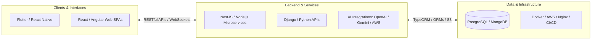

# Hi there, I'm Ilse Romero 👋
### Full-Stack Software Engineer & Mobile Developer

---

## 🚀 About Me

I am a Software Engineer and Systems Engineering student at **UAGRM**, focused on designing, building, and deploying scalable web and mobile solutions. My expertise ranges from developing high-performance cross-platform mobile apps to designing decoupled microservices architectures in the cloud.

- **Currently:** Building and optimizing mobile & web applications at **Nuxio**, managing production releases for Google Play Store and Apple App Store.
- **Backend & Architecture:** Designing resilient microservices and RESTful APIs with **Node.js** and **NestJS**, prioritizing clean architecture, high throughput, and scalability.
- **Integrations & AI:** Implementing LLM-driven workflows (OpenAI, Gemini), payment gateways (Stripe), and messaging APIs (WhatsApp, Meta, TikTok).
- **Agile Leadership:** Acting as Scrum Master to streamline delivery cadences, facilitate ceremonies, and enforce CI/CD and Git best practices.

---

## 🛠️ Technical Stack & Tooling

### **Languages & Core**

### **Frontend (Web)**

### **Mobile Development**

### **Backend**

### **Databases & Cloud / DevOps**

### **Integrations & Ecosystem**
- **AI & LLM Services:** OpenAI API, Google Gemini API
- **Payments:** Stripe integration (Subscriptions, Checkouts, Webhooks)
- **Messaging & Social APIs:** WhatsApp Business API, Meta Graph API, TikTok API
- **App Deployment:** Google Play Console, Apple App Store Connect

---

## Architectural Workflow

---

## 📂 Featured Projects & Architectures

| Project | Description | Key Tech | Repository |
| :--- | :--- | :--- | :---: |
| **Diagrammer** AI UML Modeling | Real-time collaborative UML modeling with AI assistance and automated Spring Boot code synthesis. | `React` `NestJS` `WebSockets` `Spring Boot` | [View Project ↗](https://github.com/miromero13/diagrammer) |
| **Design UI** Visual Page Builder | Drag-and-drop UI canvas with Craft.js, LLM layout synthesis, and Flutter template export. | `React` `Craft.js` `NestJS` `OpenAI` | [View Project ↗](https://github.com/miromero13/design-ui) |
| **Visor Datos SIG** Spatial GIS Viewer | Spatial GIS data migration from Shapefile to SQL Server with interactive responsive cartographic viewer. | `React` `ASP.NET Core` `Leaflet` `SQL Server` | [View Project ↗](https://github.com/miromero13/visor-datos-sig) |
| **SkillMatch** AI Skill Swapping | Collaborative skill exchange SaaS with multi-domain AI technical validation (AST, Audio, Vision). | `React` `Python` `AI Engine` `QR Verified` | [View Project ↗](https://github.com/miromero13/skill-match) |

---

## 📊 GitHub Analytics & Activity

  
  &nbsp;&nbsp;
  

---

<b>🇪🇸 Haz clic aquí para ver la versión en Español</b>

 

# Hola, soy Ilse Romero 👋
### Desarrolladora de Software Full-Stack & Móvil

---

## 🚀 Sobre mí

Soy Ingeniera de Software y estudiante de Ingeniería en Sistemas en la **UAGRM**, orientada al diseño, construcción y despliegue de soluciones web y móviles escalables. Mi experiencia abarca desde el desarrollo de aplicaciones móviles multiplataforma de alto rendimiento hasta el diseño de arquitecturas de microservicios desacopladas y contenerizadas en la nube.

- **Actualmente:** Desarrollando y optimizando aplicaciones móviles y web en **Nuxio**, gestionando entornos y publicaciones a producción en Google Play Store y Apple App Store.
- **Backend y Arquitectura:** Diseñando microservicios y APIs REST resilientes con **Node.js** y **NestJS**, priorizando arquitectura limpia, rendimiento y escalabilidad.
- **Integraciones e IA:** Implementando flujos con modelos de lenguaje (OpenAI, Gemini), pasarelas de pago (Stripe) y APIs de mensajería/redes (WhatsApp, Meta, TikTok).
- **Liderazgo Ágil:** Desempeñándome como Scrum Master para optimizar ciclos de entrega, facilitar ceremonias ágiles y asegurar buenas prácticas en CI/CD y Git.

---

## 🛠️ Stack Tecnológico

- **Lenguajes:** TypeScript, JavaScript, Python, Java, Kotlin, Dart.
- **Frontend (Web):** React, Angular, Tailwind CSS, Material UI, Shadcn UI.
- **Desarrollo Móvil:** Flutter, React Native, Capacitor, Kotlin.
- **Backend:** Node.js, NestJS.
- **Bases de Datos & Cloud:** PostgreSQL, MongoDB, Docker, AWS, Nginx, CI/CD.
- **Integraciones Especializadas:** Modelos de IA (OpenAI, Gemini), Pasarelas de Pago (Stripe), APIs de Comunicación y Redes (WhatsApp Business, Meta, TikTok).
- **Gestión Ágil:** Scrum Master, Git/GitHub, Jira, Taiga, Trello.

---

## 📂 Proyectos Destacados

| Proyecto | Descripción | Tecnologías Clave | Repositorio |
| :--- | :--- | :--- | :---: |
| **Diagrammer** Modelado UML con IA | Plataforma colaborativa en tiempo real con WebSockets y síntesis automática de código Spring Boot. | `React` `NestJS` `WebSockets` `Spring Boot` | [Ver Proyecto ↗](https://github.com/miromero13/diagrammer) |
| **Design UI** Creador Visual de UI | Canvas drag-and-drop con Craft.js, síntesis de layouts con IA y exportación a código Flutter. | `React` `Craft.js` `NestJS` `OpenAI` | [Ver Proyecto ↗](https://github.com/miromero13/design-ui) |
| **Visor Datos SIG** Visor Geoespacial SIG | Migración de datos espaciales Shapefile a SQL Server con visualizador cartográfico interactivo. | `React` `ASP.NET Core` `Leaflet` `SQL Server` | [Ver Proyecto ↗](https://github.com/miromero13/visor-datos-sig) |
| **SkillMatch** Intercambio de Habilidades | Plataforma SaaS de intercambio colaborativo con validación técnica por IA (AST, Audio, Visión). | `React` `Python` `Motor IA` `Pasaporte QR` | [Ver Proyecto ↗](https://github.com/miromero13/skill-match) |

---

  Let's build scalable and reliable software together. Crafted by <a href="https://github.com/miromero13">@miromero13</a>

